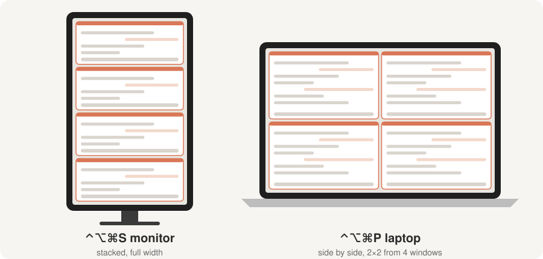

# Stack Claude

Two hotkeys that line up every Claude desktop window on your Mac: one for a vertical monitor, one for your laptop screen.



| Hotkey | Where | What it does |
|---|---|---|
| **⌃⌥⌘S** | Vertical monitor | Stacks every Claude window top to bottom, full width, adding a column once they would get too short |
| **⌃⌥⌘P** | Laptop screen | Side by side: 3 across, a 2×2 grid at 4 windows, 3 across in 2 rows at 5 or 6, wider rows after that |

⌃⌥⌘ is Control + Option + Command, held together.

- **Same order every time.** Oldest window first, so each chat stays in its spot.
- **Never squashed.** Claude won't let a window get shorter than 320px, so once windows would go below that, it adds a column instead.
- **No vertical monitor plugged in?** ⌃⌥⌘S tiles them on your main screen instead.
- **Minimised windows come back** and take their place.

## Install

You need [Hammerspoon](https://www.hammerspoon.org), a free, open-source Mac app that runs small scripts like this one.

1. Install Hammerspoon and open it:

   ```
   brew install --cask hammerspoon
   open -a Hammerspoon
   ```

   It asks for Accessibility access the first time. Switch it on in **System Settings > Privacy & Security > Accessibility** (it only appears in that list after this first launch).

2. Get Stack Claude and see what the installer will change:

   ```
   git clone https://github.com/statar95/stack-claude.git ~/stack-claude
   ~/stack-claude/install.sh
   ```

3. Install it:

   ```
   ~/stack-claude/install.sh --execute
   ```

Open a few Claude windows and press ⌃⌥⌘P.

The installer quits and reopens Hammerspoon so it picks up the change. It adds one line to `~/.hammerspoon/init.lua` and links the script from this folder, so `git pull` brings in updates. Running it again changes nothing.

## Change the keys or spacing

Edit the line the installer added to `~/.hammerspoon/init.lua`, then choose **Reload Config** from the Hammerspoon menu bar icon:

```lua
stackClaude = require("stack-claude").start({ stackKey = "m", laptopKey = "l", gap = 10 })
```

| Option | Default | |
|---|---|---|
| `mods` | `{ "ctrl", "alt", "cmd" }` | Modifier keys for both hotkeys |
| `stackKey` | `"s"` | Monitor layout |
| `laptopKey` | `"p"` | Laptop layout |
| `gap` | `6` | Pixels between windows |
| `maxColumns` | `3` | Windows per row in the laptop layout before it adds a row. A laptop fits 2 rows, so past 6 windows the rows get wider anyway |
| `minHeight` | `320` | Shortest a window gets before a column is added. Claude refuses to go below 320 |
| `app` | `"Claude"` | The app whose windows it arranges |

## Why Hammerspoon

Moving another app's windows needs macOS's Accessibility permission. The first version of this was a Quick Action that launched a small app, and macOS ties that permission to the app's exact build, so every update quietly revoked it. Hammerspoon holds the permission once, and the script runs inside it.

## Troubleshooting

**Claude isn't running, or has no windows.** You'll see a short "No Claude windows open" message, and nothing moves.

**Nothing happens.** Check Hammerspoon is running (it has a menu bar icon) and is switched on in Accessibility. Its **Console** in the menu bar menu shows any errors.

**Another app uses ⌃⌥⌘S or ⌃⌥⌘P.** Pick different keys (above).

**One window overlaps its neighbour.** The main Claude window, the one with the sidebar, won't go narrower than about 600px. Pop-out chat windows have no such limit. So whenever the columns are narrower than that (3 or more across on a laptop, 2 columns on a vertical monitor), the main window spills 100px or so into the next one. Close the main window and work in pop-outs, or keep fewer windows open.

## Uninstall

Delete the `stackClaude = require("stack-claude")...` line from `~/.hammerspoon/init.lua`, then:

```
rm ~/.hammerspoon/stack-claude.lua
```

and reload Hammerspoon.
